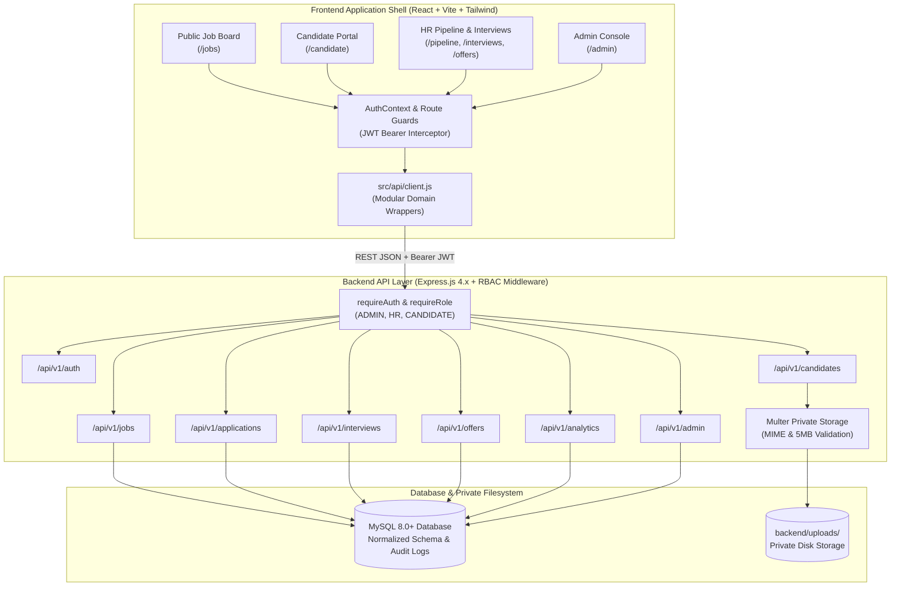

# Project 1: Smart Recruitment & Applicant Tracking System (ATS)

> A production-structured, enterprise-grade Applicant Tracking System (ATS) built with Node.js, Express.js, MySQL, JWT Authentication, Multer Private Storage, and a modular React (Vite) frontend with Tailwind CSS.

---

## 1. System Architecture Overview



---

## 2. Quick Start & Step-by-Step Setup

### Prerequisites
- **Node.js**: v18.0.0 or higher (`node -v`)
- **npm**: v9.0.0 or higher (`npm -v`)
- **MySQL**: 8.0+ installed and running locally or in Docker.

---

### Step 1: Install Dependencies
From the repository root directory, run:
```bash
# 1. Install root dependencies
npm install

# 2. Install backend dependencies
cd backend && npm install

# 3. Install frontend dependencies
cd ../frontend && npm install
cd ..
```

---

### Step 2: Configure Environment Variables
Copy the template files:
```bash
# Backend environment configuration
cp backend/.env.example backend/.env

# Frontend environment configuration
cp frontend/.env.example frontend/.env
```

Ensure `backend/.env` points to your MySQL server:
```env
PORT=5000
NODE_ENV=development

DB_HOST=localhost
DB_PORT=3306
DB_USER=root
DB_PASSWORD=your_mysql_password
DB_NAME=smart_ats_db

JWT_SECRET=production_grade_super_secret_ats_jwt_signing_key_2026
JWT_EXPIRES_IN=24h
UPLOAD_DIR=./uploads
CLIENT_URL=http://localhost:5173
```

---

### Step 3: Run Database Migrations & Synthetic Seed Data
Run the automated migration and seed runner:
```bash
npm run db:seed
```
This script will:
1. Ensure the `smart_ats_db` database exists with `utf8mb4_unicode_ci` encoding.
2. Execute `database/migrations/001_init_schema.sql` creating all 11 normalized tables with foreign keys and unique constraints.
3. Populate `database/seed/seed_data.sql` with synthetic test accounts, jobs, applications across all stages, scheduled interviews, and onboarding tasks.

---

### Step 4: Start Backend & Frontend Development Servers

#### Terminal 1 (Backend API):
```bash
cd backend
npm run dev
# Server boots on http://localhost:5000 (API at http://localhost:5000/api/v1)
```

#### Terminal 2 (Frontend Client):
```bash
cd frontend
npm run dev
# Frontend boots on http://localhost:5173
```

---

## 3. Synthetic Demo Credentials (Ready to Test)

All seeded demo accounts use the standard password: **`Password123!`**

| Role | Email | Password | Permissions & Views Accessible |
| :--- | :--- | :--- | :--- |
| **System Admin** | `admin@novatech.io` | `Password123!` | Full Admin Console (`/admin`), User Provisioning, Role Alterations, System Audit Logs, Analytics. |
| **HR Lead** | `hr@novatech.io` | `Password123!` | Job Management (`/hr/jobs`), Candidate Pipeline (`/pipeline`), Interviews (`/interviews`), Offers (`/offers`), Analytics (`/analytics`). |
| **Candidate 1** | `alex.rivera@example.com` | `Password123!` | Candidate Portal (`/candidate`), Stage Tracker, Resume Vault, Offer Acceptance (`OFFERED` stage). |
| **Candidate 2** | `elena.rostova@example.com` | `Password123!` | Candidate Portal (`/candidate`), Applied to Lead Cloud DevOps (`SELECTED` stage). |
| **Candidate 3** | `priya.sharma@example.com` | `Password123!` | Candidate Portal (`/candidate`), Interview Scheduled (`INTERVIEW` stage). |

*(Note: The login page includes 1-click Quick-Fill buttons for instant demo switching).*

---

## 4. Automated Testing Suite

The backend includes a comprehensive Jest + Supertest test suite in `tests/backend/rbac_and_pipeline.test.js` validating:
1. **Unauthorized Role Denial (403)**: Asserts that candidates and unauthenticated users are rejected when attempting admin or pipeline stage transitions.
2. **Valid Stage Transition + Mandatory Audit Log**: Verifies stage state machine promotion and audit trail persistence.
3. **Hiring Analytics Empty-State Safety**: Ensures zero-division safety and absence of `NaN` or `Infinity` when no data exists.

Run the test suite:
```bash
npm run test:backend
```

---

## 5. Executive Hiring KPIs & Mathematical Definitions

The analytics engine (`GET /api/v1/analytics/summary`) computes exact recruitment metrics with safe zero-division fallbacks:

| KPI Metric | Exact Mathematical Formula / Denominator | Safe Fallback |
| :--- | :--- | :---: |
| **Total Open Jobs** | $\text{COUNT}(\text{jobs where status} = \text{'PUBLISHED'})$ | `0` |
| **Application Volume** | $\text{COUNT}(\text{applications in filtered scope})$ | `0` |
| **Applied to Screening Rate** | $\left(\frac{\text{Applications reaching SCREENING}}{\text{Total APPLIED}}\right) \times 100$ | `0.0%` |
| **Screening to Interview Rate**| $\left(\frac{\text{Applications reaching INTERVIEW}}{\text{Applications reaching SCREENING}}\right) \times 100$ | `0.0%` |
| **Interview to Selected Rate** | $\left(\frac{\text{Applications reaching SELECTED}}{\text{Applications reaching INTERVIEW}}\right) \times 100$ | `0.0%` |
| **Selected to Offered Rate** | $\left(\frac{\text{Applications reaching OFFERED}}{\text{Applications reaching SELECTED}}\right) \times 100$ | `0.0%` |
| **Average Time-to-Hire (Days)**| $\text{AVG}(\text{DATEDIFF}(\text{offer.responded\_at}, \text{application.applied\_at})) \text{ for status} = \text{'ACCEPTED'}$ | `0.0` days |
| **Offer Acceptance Rate** | $\left(\frac{\text{Offers ACCEPTED}}{\text{Total Offers ISSUED}}\right) \times 100$ | `0.0%` |
| **Notification Delivery SLA** | $\left(\frac{\text{Notifications SENT or SIMULATED}}{\text{Total Notifications Recorded}}\right) \times 100$ | `100.0%` |

---

## 6. Teammate Division of Responsibility & Git Workflow

### Modular File Ownership (Zero Merge Conflict Architecture)
Teammates work **exclusively** within their designated files under `frontend/src/modules/`:

- **Teammate 1 (Admin)**: `src/modules/admin/AdminDashboard.jsx`
- **Teammate 2 (Jobs)**: `src/modules/hr-jobs/JobManagementPage.jsx` & `PublicJobBoard.jsx`
- **Teammate 3 (Pipeline)**: `src/modules/hr-pipeline/HrPipelineBoard.jsx`
- **Teammate 4 (Interviews & Offers)**: `src/modules/interviews-offers/InterviewSchedulerPage.jsx` & `OfferOnboardingPage.jsx`
- **Teammate 5 (Candidate Experience)**: `src/modules/candidate/CandidateDashboard.jsx`
- **Teammate 6 (Analytics & BI)**: `src/modules/analytics/HiringAnalyticsPage.jsx`

### Git Branching Protocol
1. Create a dedicated branch for your feature:
   ```bash
   git checkout -b feature/<module-name>
   # e.g. git checkout -b feature/pipeline-board
   ```
2. Commit your work following Conventional Commits:
   ```bash
   git commit -m "feat(pipeline): add drag-and-drop card interaction"
   ```
3. Before submitting a Pull Request, rebase with `main`:
   ```bash
   git checkout main
   git pull origin main
   git checkout feature/<module-name>
   git rebase main
   ```
4. Open a PR targeting `main`. Do not modify shared infrastructure (`src/api/client.js`, `src/App.jsx`, `backend/`) without Team Lead approval.

---

## 7. Additional Documentation Reference

- **[API Contract Specification](docs/API_CONTRACT.md)**: Full endpoint reference, request bodies, query params, and JSON responses.
- **[Permission & Security Matrix](docs/PERMISSION_MATRIX.md)**: Detailed RBAC table and file privacy architecture.
- **[4-Week Work Distribution Plan](docs/WORK_DISTRIBUTION.md)**: Qveto framework phase milestones and deliverables.

