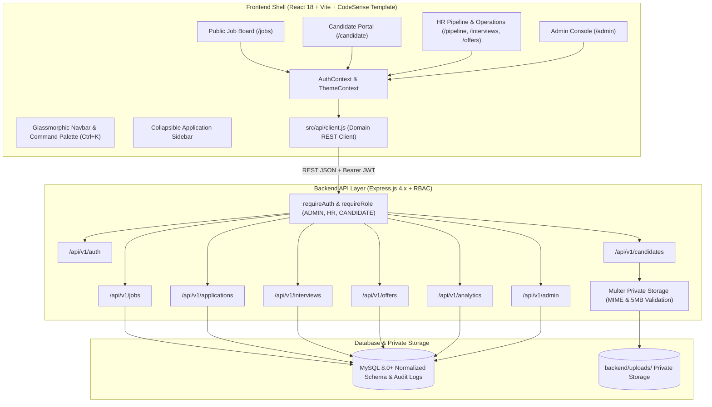

# Smart ATS

> **Enterprise-Grade Smart Recruitment & Applicant Tracking System**

Smart ATS is a production-structured, full-stack recruitment platform engineered for high-velocity hiring teams, candidates, and administrators. Built with a modern, high-contrast React (Vite) frontend adapted from the **CodeSense** design system, an Express.js REST gateway, private Multer disk storage, and a normalized MySQL 8.0 relational database with strict role-based access control (RBAC).

---

## 📌 Table of Contents

- [Overview & About](#-overview)
- [Application UI Tour & Shell Architecture](#-application-ui-tour--shell-architecture)
- [Key Features](#-key-features)
- [Architecture & System Design](#-architecture--system-design)
- [Technology Stack](#-technology-stack)
- [Project Structure](#-project-structure)
- [Quick Start & Step-by-Step Setup](#-quick-start--step-by-step-setup)
- [Running the Application](#-running-the-application)
- [Synthetic Demo Credentials](#-synthetic-demo-credentials)
- [Automated Testing & Verification](#-automated-testing--verification)
- [Executive Hiring KPIs & Metrics](#-executive-hiring-kpis--metrics)
- [Teammate Division of Responsibility](#-teammate-division-of-responsibility)
- [API Contract Reference](#-api-contract-reference)
- [License & Attribution](#-license--attribution)

---

## 📖 Overview

Modern technical recruitment demands strict role separation, seamless candidate pipelines, transparent interview scorecards, and verifiable audit trails. **Smart ATS** delivers an enterprise recruitment suite featuring:

1. **Candidate Discovery & 1-Click Application**: Candidates can browse open requisitions, view salary ranges, and submit tailored applications with private disk-persisted PDF/DOCX resumes.
2. **6-Stage Recruiter Kanban Pipeline**: HR recruiters can visually transition candidate applications across stages (`APPLIED` ➔ `SCREENING` ➔ `INTERVIEW` ➔ `SELECTED` ➔ `OFFERED` ➔ `HIRED` or `REJECTED`) with automated validation.
3. **Virtual Interview Scheduler & Scorecards**: Schedule video rounds, track interviewer assignments, and record qualitative feedback with weighted numerical scores (1–5).
4. **Offer Generation & Pre-Hire Onboarding**: Generate formal employment contracts, manage candidate accept/decline responses, and track pre-hire checklist items.
5. **Real-Time Hiring Analytics**: Calculate executive KPIs including conversion rates, average time-to-hire, offer acceptance ratios, and SLA performance with safe zero-division fallbacks.
6. **System Administration & Audit Logs**: System administrators maintain granular governance over user accounts, role elevations, and persistent compliance audit trails.

---

## 🎨 Application UI Tour & Shell Architecture

Adapted directly from the **CodeSense Design System**, Smart ATS delivers a cohesive developer-grade experience:

### 1. Dual-Theme Engine (GitHub Dark & Clean Light)
- **GitHub Dark (`#0d1117`)**: High-contrast, accessibility-focused dark palette with glowing accents and subtle ambient mesh glows.
- **Clean Light (`#F6F8FB`)**: Crisp, minimal light palette with high-readability typography.
- **Instant Toggle & System Preference**: Seamless switching between themes with zero layout shifts or flashing (`.no-transition`).

### 2. Universal Command Palette (`Ctrl+K` / `⌘K`)
- Rapid keyboard-driven navigation across all platform areas (Requisitions, Pipeline, Interviews, Offers, Analytics, Administration).
- Instant actions including theme switching and account management.

### 3. Collapsible Multi-Section Sidebar
- Persistent collapse/expand state remembered across sessions (`localStorage`).
- Categorized accordions for **Talent Discovery**, **Recruitment Pipeline**, and **Governance & Analytics**.
- Role-aware filtering: displays only pertinent operations to Candidates, HR Leads, and Administrators.
- Responsive mobile drawer with backdrop blur.

### 4. Glassmorphic Top Navigation Bar
- 68px glassmorphic header with brand emblem, search trigger, status indicators, and notification areas.
- Profile menu with user initials avatar, role badge, organization metadata, and secure sign-out.

---

## ✨ Key Features

- **⚡ 6-Stage Recruiter Kanban Workflow**: Drag-and-drop or modal-driven stage promotion with required rejection rationales and interview triggers.
- **🔒 Enterprise RBAC & Security**: Strict JWT Bearer token authentication with role enforcement (`ADMIN`, `HR`, `CANDIDATE`).
- **📁 Multer Private Resume Vault**: Strict MIME-type checking (PDF, DOC, DOCX) and 5MB payload limits with zero public asset exposure.
- **📊 Mathematical Recruitment Analytics**: Real-time conversion funnel calculation with bulletproof zero-division safeguards (`0.0%` fallbacks).
- **📝 Automated Audit Trail**: Every stage change, job state transition, and user permission modification writes to an immutable database audit log.
- **🎯 1-Click Demo Account Quick-Fill**: Instant demo credential fill on the login screen for System Admin, HR Lead, and Candidate.

---

## 🏛️ Architecture & System Design



---

## 💻 Technology Stack

| Layer | Technologies |
| :--- | :--- |
| **Frontend Framework** | React 18, Vite 6, React Router DOM 6 |
| **Design System & Styling**| CodeSense Design System, Tailwind CSS, Custom CSS Variables, Lucide Icons |
| **Backend Runtime** | Node.js (v18+), Express.js 4.x |
| **Authentication & Security**| JWT (JSON Web Tokens), bcryptjs, Role-Based Access Control (RBAC) |
| **File Storage** | Multer Private Disk Storage (MIME validated, non-public directory) |
| **Database** | MySQL 8.0+ (InnoDB, UTF8mb4, Normalized Schema) |
| **Testing Suite** | Jest 29, Supertest 7 |

---

## 📂 Project Structure

```text
E:\SR&ATS\
├── backend/
│   ├── config/              # MySQL connection pool & environment setup
│   ├── controllers/         # Business logic (Jobs, Applications, Interviews, Offers, Analytics)
│   ├── middleware/          # requireAuth, requireRole, Multer file upload filters
│   ├── routes/              # Express API routers (v1 endpoints)
│   ├── uploads/             # Private resume disk storage (excluded from public web)
│   └── server.js            # Express application entrypoint
├── database/
│   ├── migrations/          # 001_init_schema.sql (11 normalized tables)
│   └── seed/                # seed_data.sql & automated synthetic seeder
├── docs/                    # API specifications, permission matrix, work distribution
├── frontend/
│   ├── src/
│   │   ├── api/             # client.js (Axios REST client with JWT interceptor)
│   │   ├── components/      # Common UI components (Navbar, Sidebar, CommandPalette, ThemeToggle)
│   │   ├── context/         # AuthContext.jsx, ThemeContext.jsx
│   │   ├── modules/         # Domain views (Candidate, HR Pipeline, Interviews, Admin, Analytics)
│   │   ├── App.jsx          # Root application shell with collapsible sidebar & router
│   │   ├── App.css          # CodeSense template design system & responsive layout
│   │   └── index.css        # Themed CSS variables, base resets, scrollbar, dark mode bridge
│   ├── index.html           # Inter & JetBrains Mono font links, meta headers
│   └── vite.config.js       # Vite configuration with backend proxy
├── tests/
│   └── backend/             # Jest & Supertest automated RBAC and pipeline test suite
└── package.json             # Root orchestration scripts
```

---

## ⚡ Quick Start & Step-by-Step Setup

### Prerequisites
- **Node.js**: v18.0.0 or higher (`node -v`)
- **npm**: v9.0.0 or higher (`npm -v`)
- **MySQL**: 8.0+ running locally or in Docker.

---

### Step 1: Install Dependencies
From the repository root:
```bash
# 1. Install root dependencies
npm install

# 2. Install backend dependencies
cd backend && npm install

# 3. Install frontend dependencies
cd ../frontend && npm install
cd ..
```

---

### Step 2: Configure Environment Variables
Copy the template files:
```bash
# Backend environment configuration
cp backend/.env.example backend/.env

# Frontend environment configuration
cp frontend/.env.example frontend/.env
```

Ensure `backend/.env` points to your MySQL database:
```env
PORT=5000
NODE_ENV=development

DB_HOST=localhost
DB_PORT=3306
DB_USER=root
DB_PASSWORD=your_mysql_password
DB_NAME=smart_ats_db

JWT_SECRET=production_grade_super_secret_ats_jwt_signing_key_2026
JWT_EXPIRES_IN=24h
UPLOAD_DIR=./uploads
CLIENT_URL=http://localhost:5173
```

---

### Step 3: Run Database Migrations & Synthetic Seed Data
```bash
npm run db:seed
```
This script will:
1. Ensure the `smart_ats_db` database exists with `utf8mb4_unicode_ci` encoding.
2. Execute `database/migrations/001_init_schema.sql` creating all 11 tables with constraints and indexes.
3. Populate synthetic test accounts, jobs, applications across all stages, scheduled interviews, and onboarding tasks.

---

## 🏃 Running the Application

### 1. Start Backend Development Server (Port 5000)
```bash
cd backend
npm run dev
# Server boots on http://localhost:5000 (API at http://localhost:5000/api/v1)
```

### 2. Start Frontend Development Server (Port 5173)
```bash
cd frontend
npm run dev
# Frontend boots on http://localhost:5173
```

Open your browser at: **`http://localhost:5173`**

---

## 🔐 Synthetic Demo Credentials

All seeded demo accounts share the standard password: **`Password123!`**

| Role | Email | Password | Permissions & Views Accessible |
| :--- | :--- | :--- | :--- |
| **System Admin** | `admin@novatech.io` | `Password123!` | Full Admin Console (`/admin`), User Directory, Role Alterations, System Audit Logs, Analytics. |
| **HR Lead** | `hr@novatech.io` | `Password123!` | Job Management (`/hr/jobs`), Candidate Pipeline (`/pipeline`), Interviews (`/interviews`), Offers (`/offers`), Analytics (`/analytics`). |
| **Candidate 1** | `alex.rivera@example.com` | `Password123!` | Candidate Portal (`/candidate`), Stage Tracker, Resume Vault, Offer Acceptance (`OFFERED` stage). |
| **Candidate 2** | `elena.rostova@example.com` | `Password123!` | Candidate Portal (`/candidate`), Applied to Lead Cloud DevOps (`SELECTED` stage). |
| **Candidate 3** | `priya.sharma@example.com` | `Password123!` | Candidate Portal (`/candidate`), Interview Scheduled (`INTERVIEW` stage). |

*(Note: The login page includes 1-click Quick-Fill buttons for instant demo switching).*

---

## 🧪 Automated Testing & Verification

The test suite validates RBAC security, state machine transitions, and analytics safety:

```bash
# Run backend tests from root
npm run test:backend
```

Key test scenarios:
1. **Unauthorized Role Denial (403)**: Asserts that candidates and unauthenticated requests are rejected when accessing administrative or recruiter endpoints.
2. **Valid Stage Transition + Mandatory Audit Log**: Confirms that stage promotions persist an immutable record into `audit_logs`.
3. **Hiring Analytics Empty-State Safety**: Guarantees zero-division safety and absence of `NaN` or `Infinity` when calculating recruitment rates.

---

## 📊 Executive Hiring KPIs & Metrics

The analytics engine (`GET /api/v1/analytics/summary`) computes exact recruitment metrics:

| KPI Metric | Exact Mathematical Formula / Denominator | Safe Fallback |
| :--- | :--- | :---: |
| **Total Open Jobs** | $\text{COUNT}(\text{jobs where status} = \text{'PUBLISHED'})$ | `0` |
| **Application Volume** | $\text{COUNT}(\text{applications in filtered scope})$ | `0` |
| **Applied to Screening Rate** | $\left(\frac{\text{Applications reaching SCREENING}}{\text{Total APPLIED}}\right) \times 100$ | `0.0%` |
| **Screening to Interview Rate**| $\left(\frac{\text{Applications reaching INTERVIEW}}{\text{Applications reaching SCREENING}}\right) \times 100$ | `0.0%` |
| **Interview to Selected Rate** | $\left(\frac{\text{Applications reaching SELECTED}}{\text{Applications reaching INTERVIEW}}\right) \times 100$ | `0.0%` |
| **Selected to Offered Rate** | $\left(\frac{\text{Applications reaching OFFERED}}{\text{Applications reaching SELECTED}}\right) \times 100$ | `0.0%` |
| **Average Time-to-Hire (Days)**| $\text{AVG}(\text{DATEDIFF}(\text{offer.responded\_at}, \text{application.applied\_at})) \text{ for status} = \text{'ACCEPTED'}$ | `0.0` days |
| **Offer Acceptance Rate** | $\left(\frac{\text{Offers ACCEPTED}}{\text{Total Offers ISSUED}}\right) \times 100$ | `0.0%` |
| **Notification Delivery SLA** | $\left(\frac{\text{Notifications SENT or SIMULATED}}{\text{Total Notifications Recorded}}\right) \times 100$ | `100.0%` |

---

## 👥 Teammate Division of Responsibility

### Zero Merge Conflict Architecture
- **Principal Architect**: Owns Backend API, Database Migrations, RBAC Middleware, Design System Integration, and Central API Client.
- **Teammate 1 (Candidate Experience & Public Portal)**:
  - `src/modules/candidate/CandidateDashboard.jsx` (Application timeline, resume upload, offer decisions)
  - `src/modules/hr-jobs/PublicJobBoard.jsx` (Public job catalog, search filters, 1-click apply)
- **Teammate 2 (Recruiter Pipeline & Requisitions)**:
  - `src/modules/hr-jobs/JobManagementPage.jsx` (Requisition publishing lifecycle: DRAFT/PUBLISHED/CLOSED)
  - `src/modules/hr-pipeline/HrPipelineBoard.jsx` (6-stage Kanban board, candidate detail drawer)
- **Teammate 3 (Interviews, Offers & Onboarding)**:
  - `src/modules/interviews-offers/InterviewSchedulerPage.jsx` (Virtual interview booking, scorecards)
  - `src/modules/interviews-offers/OfferOnboardingPage.jsx` (Formal offer generator, onboarding checklist)
- **Teammate 4 (Administration & Analytics)**:
  - `src/modules/admin/AdminDashboard.jsx` (User directory, RBAC provisioning, audit logs)
  - `src/modules/analytics/HiringAnalyticsPage.jsx` (Executive KPIs, visual conversion funnel)

---

## 🔌 API Contract Reference

| Method | Endpoint | Description | Role Required |
| :--- | :--- | :--- | :--- |
| `POST` | `/api/v1/auth/register` | Register candidate account | Public |
| `POST` | `/api/v1/auth/login` | Authenticate user & issue JWT | Public |
| `GET` | `/api/v1/auth/me` | Fetch authenticated user profile | Authenticated |
| `GET` | `/api/v1/jobs` | Browse published or managed jobs | Public / HR / Admin |
| `POST` | `/api/v1/jobs` | Create new job requisition | HR / Admin |
| `POST` | `/api/v1/applications/apply` | Submit job application with resume | Candidate |
| `GET` | `/api/v1/applications/pipeline`| Fetch Kanban applications by stage | HR / Admin |
| `PATCH`| `/api/v1/applications/:id/stage`| Transition application stage | HR / Admin |
| `POST` | `/api/v1/interviews` | Schedule interview round | HR / Admin |
| `POST` | `/api/v1/offers` | Issue employment offer | HR / Admin |
| `PATCH`| `/api/v1/offers/:id/respond`| Accept or decline offer | Candidate |
| `GET` | `/api/v1/analytics/summary` | Fetch executive hiring KPIs | HR / Admin |
| `GET` | `/api/v1/admin/users` | List all system accounts | Admin |
| `GET` | `/api/v1/admin/audit-logs` | Fetch system audit log trail | Admin |

---

## 📄 License & Attribution
Developed as an enterprise software engineering solution adhering to the **CodeSense** template specifications.
